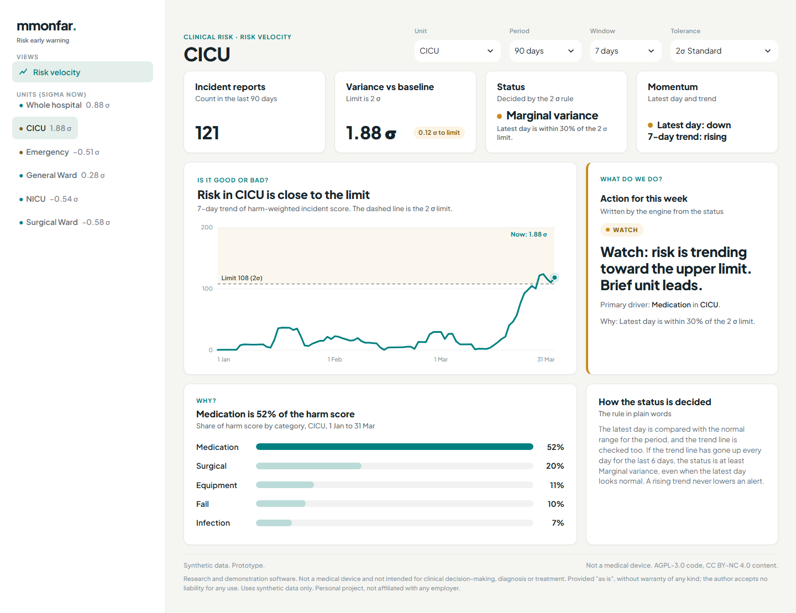
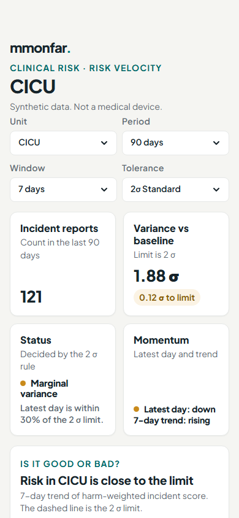

# Hospital Risk Velocity (v2.1)

Clinical risk dashboard: turns a log of incident reports into a daily harm score, and shows its velocity and acceleration, a control limit and a rising-trend check.
**Status: Prototype · synthetic data · not a medical device.**

---

## What it does

Counting incidents says little about whether risk is building up. This dashboard scores each incident by harm level, adds the scores up per calendar day, and then asks three questions of that daily series: is the latest day unusually high, is the trend line rising, and is the rise speeding up?

One page. The left list ranks the units by risk. The header has selectors for scope (whole hospital or one unit), analysis period, kinetic window (3, 7 or 15 days) and tolerance mode (1, 2 or 3 sigma). The cards are:

- **Status**: one of *Within tolerance*, *Marginal variance*, *Outside tolerance* or *No data*, with a plain-words action and a "Why" line (for example "Raised by the trend: it rose 6 days in a row").
- **Four KPI cards**, including **Momentum (latest day)**: whether the acceleration on the latest complete day is increasing, flat or decreasing. The card shows the trend state beside it, so a cooling latest day is never read as all clear while the trend line is still rising.
- **Trend chart**: daily harm score with trend line, control limit and a "Now" marker.
- **Drivers**: the unit and category with the largest total harm score in the selected period.
- **How the status is decided**: the rule in plain words.

The data are generated, not loaded: a seeded generator (`clinical_risk_dashboard.sample_data.generate_incidents`) produces 90 days of synthetic incident reports for five units and five categories, with a surge of medication events in one unit over the last 14 days so the dashboard has a signal to find.

## How to run

Python 3.11 or newer.

```bash
git clone https://github.com/mmonfar/hospital-risk-velocity.git
cd hospital-risk-velocity
python -m venv .venv
.venv/bin/pip install -e ".[dev]"        # Windows: .venv\Scripts\pip install -e ".[dev]"
.venv/bin/streamlit run app.py          # run from the repository root
.venv/bin/pytest                          # optional: the test suite (228 tests)
```

Everything installs from PyPI (numpy, pandas, streamlit). The theme and its font are bundled, so the app needs no other folder or external service.

## What it looks like (v2.1.0)
Desktop (1440 px):



Phone (390 px):



The page opens on the unit with the highest risk. Each card says in words what it shows. The status card gives the reason in one line. The Momentum card shows the latest day and the trend side by side, so the two never contradict each other.

## The method in brief

1. **Harm score.** Each incident has a harm level A to I (NCC MERP categories, A = no error, I = death). Its weight is the square of its ordinal position (A = 1, B = 4, ... I = 81), so severe events dominate a daily sum.
2. **Daily series, calendar-linear.** Weighted scores are summed per day. Days are reindexed to a complete calendar from the first to the last event, and a day with no events counts as zero. The x axis is therefore linear in calendar time, and every mean, limit and rate is per calendar day, not per day with a report.
3. **Velocity and acceleration.** The daily score is smoothed with a trailing moving average over the chosen window `w` (no line before a full window; trailing is a choice by logic, not from a source). Velocity is the difference of the smoothed series over `w` days divided by `w`; acceleration is the same operation on velocity. The first 3 x `w` days have no complete row, so a shorter period reads *No data*.
4. **Control limit and status.** Mean and standard deviation are taken from the daily scores over the selected period. The limit for the `w`-day average is mean + sigma x sd / sqrt(`w`) (our algebra from NIST/SEMATECH e-Handbook 6.3.2.4 and SAS/QC EWMACHART; at 7 days and 2 sigma that is mean + 0.76 daily sd). The latest complete smoothed value gives a z-score on that same scale, so the chart line is over the limit exactly when z is above sigma: above the chosen sigma is *Outside tolerance*, above 0.7 x sigma is *Marginal variance*, otherwise *Within tolerance*.
5. **Rising-trend rule.** If the smoothed trend line rose on each of the last 6 days, a status that would read *Within tolerance* is raised to *Marginal variance*. The trend can raise a status to Marginal only; it never lowers a status and never overrides *Outside tolerance*. The 6-day run is a run-chart convention from general statistical process control practice. It is not yet tied to a published source.
6. **Momentum card.** The latest complete day's acceleration is labelled *Increasing* above +0.01, *Decreasing* below -0.01 and *Flat* in between. This is a display cut-off. The card states that it describes the latest day and shows the 6-day trend state next to it.

## Parameters

| Parameter | Value | Where | Status |
|---|---|---|---|
| Harm weights | square of the ordinal position of level A to I (1 to 81) | `risk_kinematics.harm` | Design choice |
| Kinetic window | 3, 7 or 15 days (default 7) | page selector | User input |
| Tolerance mode | 1, 2 or 3 sigma (68%, 95%, 99.7%; default 2) | page selector | User input |
| Marginal band | above 0.7 x sigma | `risk_kinematics.kinetics` | Convention, not sourced |
| Rising-trend run | 6 consecutive rising days | `TREND_RUN_DAYS` | Run-chart convention, not yet sourced |
| Momentum cut-off | +/- 0.01 acceleration | `presentation.MOMENTUM_DEADBAND` | Display threshold |
| Synthetic data | seed 7, 90 days, about 5.5 reports a day plus a 14-day surge | `sample_data` | Synthetic |

## Limitations

- Prototype on synthetic data. It has not been validated against real incident data, gives no forecast and has no tested warning performance (sensitivity, false alerts).
- The harm weights, the 0.7 x sigma band and the 6-day run are conventions, not calibrated or sourced values.
- A single daily total is sensitive to reporting volume: more reporting (not more harm) raises the score. Reporting culture is not modelled.
- Mean and standard deviation come from the selected period itself, so a long surge inside a short period inflates the baseline.
- The latest complete day is the one judged; periods shorter than about 2 x window days return *No data*.
- Near-zero variation gives an unstable z-score.

## Project layout

```
src/risk_kinematics/           engine: harm scores, velocity, acceleration, control limit, status, trend rule
src/clinical_risk_dashboard/   Streamlit page, HTML parts (view.py), words and colours (presentation.py),
                               seeded synthetic data generator, stylesheet and font (static/)
tests/engine/                  engine tests
tests/app/                     page, presentation, view and data tests (synthetic data only)
```

## Licence

Code is licensed under **AGPL-3.0-or-later** (see [`LICENSE`](LICENSE)); a commercial licence is available on request from the author via [LinkedIn](https://www.linkedin.com/in/martin-monteagudo-farina/). Non-code content is under [CC BY-NC 4.0](https://creativecommons.org/licenses/by-nc/4.0/). Details in [`LICENSING.md`](LICENSING.md). The two bundled fonts keep their own SIL Open Font License 1.1 (`src/clinical_risk_dashboard/brand/fonts/OFL.txt`).

## Disclaimer

Research and demonstration software. Not a medical device and not intended for clinical decision-making, diagnosis or treatment. Provided "as is", without warranty of any kind; the author accepts no liability for any use. Uses synthetic data only.

Built with AI assistance (Claude); all code and claims reviewed by the author. See [`LICENSE`](LICENSE) for the full warranty terms.

## Independence and data notice

**Independence and data notice.** This is a personal project, developed independently in my own time and on my own equipment. It is not affiliated with, endorsed by, or representative of my employer or any other organisation. It contains no employer data, systems, code or confidential information. All data in this repository is synthetic or fictitious, and any resemblance to real patients, staff or events is coincidental. Views are my own.
